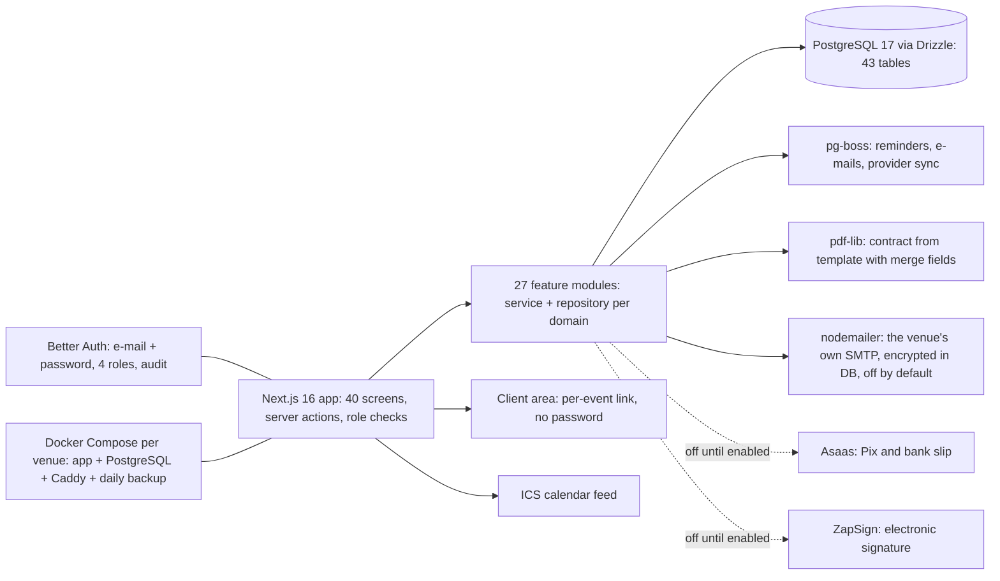

# Buffet Management System: Case Study

> A management product for party and event venues, from the first lead to the last installment: sales funnel, visits, packages, proposals, contracts as PDF, a calendar with conflict locking, installments, reports, and roles. One installation per venue, everything configurable, nothing turned on until the venue asks.
> **Source code is private.** This repository documents the project; a live walkthrough is available on request.

**Stack:** Next.js 16 with React 19, TypeScript, PostgreSQL 17, Drizzle ORM, Better Auth, pg-boss job queue, pdf-lib for contracts, nodemailer with per-venue SMTP, Zod, Tailwind CSS 4, Vitest and Playwright, Docker Compose with Caddy and daily backups per installation. Payment (Pix and bank slip via Asaas) and electronic signature (ZapSign) integrations are built and tested in sandbox, shipped disabled.

**Status:** product in development by my studio for party venues in Brazil, built from October 29 to November 17, 2026. Versions 1 and 2 are feature complete with a seeded sample venue, sales material, and an installation runbook; the first pilot installation is the next step. No venue is running it yet.

## Problem → Solution

**Problem.** Small and mid-size event venues sell with WhatsApp and spreadsheets: leads get lost between first contact and the tasting visit, proposals are retyped, the contract is a Word file, two salespeople book the same hall for the same night, and nobody knows what is overdue. Generic CRMs do not understand packages per guest, minimum guest counts, pre-reservations, or an installment plan tied to an event date.

**Solution.** One web system per venue that follows the real flow: lead, visit, proposal, contract, event on the calendar, installments, and reports, with roles for sales, operations, and finance. Version 2 adds the kitchen and operations side (menus and recipe sheets, tastings, staff schedules, suppliers, stock and purchases, event checklists, post-event surveys) and full finance (payables, cash flow, result per event). Each venue gets its own installation with its own database, brand color, SMTP, and optional payment and signature providers.

## What I built

- **Sales funnel and visits.** Leads on a board and a list with stages, source, owner, and stage history; visits scheduled per lead, marked done or no-show, with day and week lists; a capture form for the venue's website with tracked origin.
- **Packages, proposals, and contracts.** Packages priced per guest or fixed with minimum guest counts and extras; proposals built from a lead with package, extras, guest count, discount, and validity, totals computed in the service layer; configurable price rules in version 2. Contracts come from a configurable text template with merge fields, rendered to PDF inside the installation with pdf-lib, and move through generated, signed, and cancelled states.
- **Calendar with conflict locking.** Spaces with capacity and color; events and pre-reservations; a conflict lock in the service layer that refuses two bookings for the same space and time, including staff double-booking in the schedule module; a "find a free date" search; an ICS feed so the team subscribes in Google Calendar, Outlook, or iPhone without amounts or contact data.
- **Installments and finance.** Down payment plus N installments, manual settlement with date and method, overdue and upcoming views, reminder e-mails, partial payments; version 2 adds payables, cash flow, and result per event. Cancelling an event cancels the open charge at the provider and flags the installment if the provider refuses.
- **Operations in version 2.** Menus with recipe sheets, tastings, team and shift schedule, suppliers, stock and purchases, per-event checklists, post-event NPS surveys.
- **Client area.** A per-event link without password showing date, time, space, the signed contract, and the installments.
- **Users, roles, and audit.** E-mail and password login through Better Auth, four roles (admin, sales, operations, finance) enforced server-side, and an audit trail of who did what.
- **Configuration instead of code.** Venue name, logo, brand color, company data, document validators for Brazilian identifiers (including the 2026 alphanumeric company registry), SMTP credentials encrypted in the database, and feature switches for e-mail, payments, and signatures, all off by default and turned on with the venue.
- **Delivery kit.** Docker Compose per installation (app, PostgreSQL 17, Caddy, backup), an installation runbook, an update runbook, a seeded sample venue with six months of events for demos, sales material with screenshots and a video, and a user manual.

## Architecture

## Technical challenges

- **One product, one installation per venue.** The decision was explicit: no multi-tenant database. What differs between venues is configuration, never code, so the same image runs everywhere and a venue's data never shares a table with another's.
- **Conflicts that cannot slip through.** Double bookings are a business disaster. The lock lives in the service layer, covers events, pre-reservations, and staff shifts, and is covered by unit tests rather than relying on the UI.
- **Money as integers.** All amounts are stored in cents and formatted at the edge; proposal totals are computed in one place in the service, with no rules engine, so a wrong total has one place to be wrong.
- **Providers that must be safe to ship off.** Payment and signature integrations were built against sandboxes and shipped disabled; enabling one is a configuration step done with the venue, and cancellation paths were tested so an event cancelled in the system never leaves a live charge behind.
- **Built in parallel by coordinated agents.** The codebase grew from zero to version 2 in under three weeks by splitting work into non-overlapping fronts (each feature module has its own service, repository, and tests), with an independent QA review pass recorded in the repository before the sales material was produced.

## Scale

- 221 commits between October 29 and November 17, 2026
- About 38,300 lines of TypeScript and TSX
- 27 feature modules, 43 database tables, 40 screens
- 51 test files with 493 test functions, plus 5 end-to-end Playwright specs
- 2 QA reports, an installation runbook, an update runbook, and a user manual

## My role

Product owner and lead engineer: defined the scope of versions 1 and 2 with the venue workflow in mind, set the architecture (feature modules, cents, one installation per venue, everything off by default), coordinated several AI coding agents working on separate fronts, reviewed every merge, ran the QA passes, and produced the delivery kit and sales material.

---
Built by **Victor Sestrem** · [LinkedIn](https://www.linkedin.com/in/victor-sestrem/) · victor-sestrem@hotmail.com
